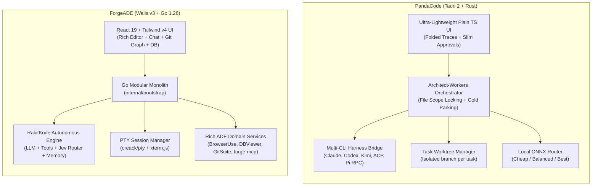
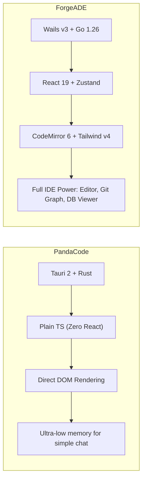
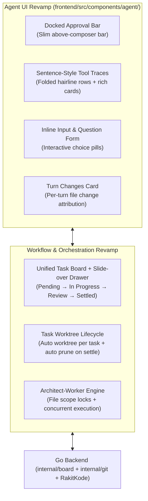
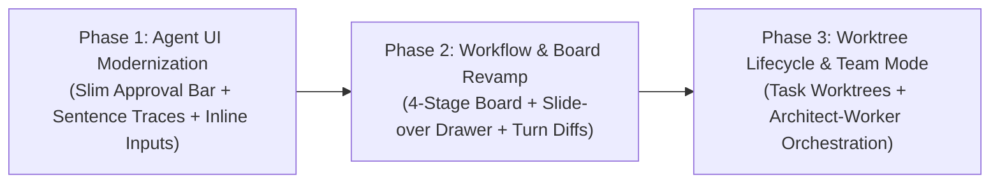

# PandaCode vs. ForgeADE: Comprehensive Study, Comparison & Agent Revamp Plan

This document presents an in-depth study of [PandaCode](https://github.com/aicodeking/pandacode) (cloned at `/data/workspace/pandacode`), a comprehensive side-by-side comparison with **ForgeADE** (`/data/workspace/forge-ade`), and an actionable architectural roadmap to revamp ForgeADE's **Agent UI** and **Workflow Engine**.

---

## 1. Executive Summary & Core Philosophy

| Attribute | PandaCode (`pandacode`) | ForgeADE (`forge-ade`) |
| :--- | :--- | :--- |
| **Origin & Focus** | Lightweight Native Desktop Workspace for Coding Agents & multi-harness orchestration | Full Native AI Development Environment (ADE) with rich CodeMirror 6 editor, visual Git suite, DB viewer, browser-use, & PTY sessions |
| **Desktop Runtime** | **Tauri 2** (Rust backend + OS System WebView) | **Wails v3** (Go 1.26 backend + OS System WebView) |
| **Frontend Stack** | **Plain TypeScript** + Direct DOM manipulation (No React, no virtual DOM, custom CSS) | **React 19** + **Tailwind CSS v4** + Pure **Zustand** stores + **CodeMirror 6** |
| **Agent Engine** | Multi-CLI Process Orchestrator (Claude Code, Codex, Kimi, ACP, MSP, Pi RPC, etc.) + Rust local runner | Built-in autonomous Go agent engine (**RakitKode**) + Dual-session PTY terminal runner (`creack/pty`) |
| **Persistence** | SQLite (`storage.rs`) + `secrets.json` | JSON Workspace metadata (`.forge/board_tasks.json`, `~/.forge/sessions/`, `.workspace/`) |
| **Multi-Agent Model** | **Architect & Workers** (1 Lead + up to 3 workers with file-scope locking, cold parking, ONNX routing) | **Subagent Delegation** (`invoke_subagent` tree, `SubagentChatPane`, `Jev` router) |
| **Worktree Strategy** | First-class per-task worktrees (`<project>-worktrees/<branch>`) with automatic prune on settle | Native Git worktree engine (`internal/git/worktree.go`), manual worktree triggers |
| **Extensibility** | Bot channels (Telegram/Slack/Discord/WhatsApp), Tart VMs, Cloud sandboxes (Daytona/Modal/E2B) | Native MCP Server (`forge-mcp`), Cordis declarative plugins, Agent Skills (`SKILL.md`), In-App Browser (`browser_*`) |



---

## 2. Deep-Dive Study of PandaCode

### 2.1 The "Architect and Workers" Team Paradigm
PandaCode’s flagship feature is its **Architect-Worker** collaboration pattern ([`docs/architect-workers.md`](file:///data/workspace/pandacode/docs/architect-workers.md)):
1. **Separation of Concerns**: The **Architect** acts as team lead; it receives user objectives, reads codebase structure, formulates a plan, and delegates discrete work units via `pandacode_dispatch_workers`.
2. **File Scope Locking (`files`)**:
   - Every worker assignment specifies an explicit write scope: e.g. `files: ["frontend/src/components/*"]`.
   - **Parallelism Rule**: Workers with disjoint (non-overlapping) write scopes run **concurrently in parallel**.
   - If two workers declare overlapping file scopes, the scheduler **serializes** them automatically to avoid git conflicts.
   - `readOnly: true` workers run concurrently without blocking.
3. **Cold Parking (Zero-Idle RAM)**:
   - When an Architect or parent worker finishes its dispatch turn and waits for child workers, its backend process exits completely ("parked").
   - Upon completion of child workers, an event wakes the Architect cold, restoring only necessary summary context. No memory is held by idle parent processes.
4. **Autonomous Failure Recovery**:
   - If a worker fails, the Architect immediately receives a dedicated turn (`Handling a failed worker`) before other workers even finish, enabling rapid retry, scope adjustment, or model escalation.
5. **Local Model Routing Ladder**:
   - A tiny local ONNX model (`model.int8.onnx`, 10–25ms latency, fully offline) classifies task complexity into Cheap, Balanced, or Best rungs. On worker failure, the router automatically escalates to a higher-tier model for up to 2 retries.

### 2.2 Task Board with Durable Stages & Seamless Drawers
PandaCode avoids the disconnection between Kanban boards and chat sessions ([`docs/task-board.md`](file:///data/workspace/pandacode/docs/task-board.md)):
- **4 Durable Stages**:
  - `Pending`: Queued ideas with title, description, harness, model, and worktree settings.
  - `In progress`: Actively executing or paused runs.
  - `Review`: Agent finished work; files changed are displayed for user verification before settling.
  - `Settled` (`completed`): Accepted work; can be reopened anytime back to `Review`.
- **Side Drawer Architecture**: Clicking any board card does not leave the board view. It slides open a right-side conversation drawer with full streaming transcript, folded tools, and composer controls.
- **Card-Level Actions**: Tasks can be started or retried with one click directly from the card.

### 2.3 Approvals & Interactive Agent Input
- **Docked Slim Approval Bar** ([`src/approval-bar.ts`](file:///data/workspace/pandacode/src/approval-bar.ts)):
  - Instead of dropping large blocks into the chat message stream, pending approvals sit in a **slim bar docked directly above the composer input**.
  - A single approval displays as one clean line: summary + `Deny` and `Approve` buttons.
  - Multiple approvals collapse into: `3 approvals needed: [Summary...] and 2 more (chevron) [Deny all] [Approve all]`.
  - Details expand on demand without jarring the scroll position.
- **Inline Interactive Questions** ([`src/agent-input.ts`](file:///data/workspace/pandacode/src/agent-input.ts)):
  - Structured questions (`ask_question` / form requests) render as clean, focused interactive forms inline within the stream, with pill radio selectors and submit buttons, avoiding modal popups that block context.

### 2.4 Sentence-Style Tool Traces & Folded Activity
- **Trace Format** ([`src/tool-trace.ts`](file:///data/workspace/pandacode/src/tool-trace.ts)):
  - Instead of dumping raw JSON tool arguments and execution blocks into the chat stream, PandaCode synthesizes tool execution into natural sentences:
    - `Ran [npm test]` (shell)
    - `Read [src/components/Agent.tsx]` (read)
    - `Edited [src/main.ts (+14 -3)]` (edit)
    - `Searched ["handleStreamResponse"]` (search)
  - Consecutive tools group cleanly: e.g., `Ran 4 searches · Read 3 files`.
  - On click, each row expands into a hairline card with syntax highlighting, diffs, or terminal logs.

### 2.5 Turn Changes & Worktree Isolation
- **Turn Change Attribution** ([`docs/turn-changes.md`](file:///data/workspace/pandacode/docs/turn-changes.md)):
  - Handshake protocol (`pandacode_track_files`) takes a snapshot before file mutation and freezes the diff immediately upon tool completion.
  - Completed turns render a compact summary card below the assistant response with added/deleted line counts.
  - Architect turns roll up all changes made by child workers into a single aggregated turn diff.
- **Per-Task Git Worktrees** ([`docs/worktrees.md`](file:///data/workspace/pandacode/docs/worktrees.md)):
  - Tasks can execute in isolated worktrees (`<project>-worktrees/<branch>`).
  - Terminal, agent runs, file tabs, and file mentions are scoped to that worktree.
  - Settling a task prompts the user to clean up the worktree and merge changes to `main`.

---

## 3. Comprehensive Comparison: PandaCode vs. ForgeADE

### 3.1 Architecture & Performance



| Dimension | PandaCode | ForgeADE | Verdict & Opportunity |
| :--- | :--- | :--- | :--- |
| **Backend Language** | Rust | Go 1.26 | Go backend in ForgeADE is fast, highly concurrent, and easier to extend with domain services. |
| **Desktop Harness** | Tauri v2 | Wails v3 | Both use native WebViews (zero Electron). ForgeADE's base memory (~80MB) is comparable. |
| **Frontend Runtime** | Plain TS (Vanilla DOM) | React 19 + Zustand | ForgeADE's React 19 + Zustand enables much richer interactive widgets (CodeMirror 6, Database Data Grids, Git Commit Graphs), but UI components need optimization to prevent visual clutter. |
| **IDE Features** | Minimal (external editor or basic view) | Full IDE (CodeMirror 6, Symbol indexer, Prettier, Syntax check) | ForgeADE significantly surpasses PandaCode in full IDE and developer environment capabilities. |
| **Specialized Tools** | Tart VMs, Cloud sandboxes, Bot connectors | In-App Browser (`browser_*`), In-App DB Viewer (SQLite/DuckDB/RocksDB), Desktop Computer Use, Remote SFTP | ForgeADE has unique developer primitives that PandaCode lacks. |

---

### 3.2 Agent UI & Conversation UX Comparison

| Feature | PandaCode Implementation | ForgeADE Current Implementation | Gap / Improvement for ForgeADE |
| :--- | :--- | :--- | :--- |
| **Tool Execution Presentation** | **Sentence-Style Traces**: Compact hairline rows (`Ran [cmd]`, `Read [file]`, `Edited [file (+N -M)]`). Folded above response. Click to inspect card. | **`ToolBlockViews.tsx`**: Expandable accordions with raw JSON inputs, full file diffs, and large work log rows inline in chat. | **High Priority**: Chat gets crowded with long tool runs. ForgeADE needs sentence-style traces and folded group summaries above the response. |
| **Tool Approvals** | **Docked Slim Approval Bar**: Sits directly above composer. Single line for single request; grouped accordion for multiple requests with `Approve All` / `Deny All`. | **`PendingApprovalCard`**: Large in-stream warning box (up to 65vh height) placed directly into the chat message list. | **High Priority**: In-stream approval cards push the composer down and disrupt conversation flow. Move to a docked bar above the composer. |
| **Agent Questions (`ask`)** | **Inline Form (`agent-input.ts`)**: Rendered directly in-flow with clean choice pills, text inputs, and submit button. | **`AgentQuestionModal.tsx` & in-stream card**: Opens a full modal dialog or renders a bulky question card. | **Medium Priority**: Inline choice pills and streamlined prompt form in the chat stream feel much smoother than a modal dialog. |
| **Composer / Input Bar** | Clean bar with Mode selector, Team toggle, Queue status, Worktree chip, and Attachments sketcher. | `AgentTaskInputBar.tsx`: Very capable (modes, reasoning, prompt stash, steering queue, `@mentions`, `/slash`, `$skills`), but visually crowded. | **Medium Priority**: Integrate docked approval bar, active worktree chip, and Team Mode toggle into a clean header/footer strip. |
| **Turn Diffs / Changes** | **Turn Changes Card**: Compact per-turn changed files list (+/- counts) with instant unified/split diff modal under response. | **`ChangesPane` in Sidebar**: Shows current working tree git changes or session diffs globally in the right sidebar. | **High Priority**: Users cannot easily see what an agent changed in *this specific turn* vs previous turns. Per-turn diff summaries are essential. |
| **Queueing & Steering** | Dedicated queueing while agent is running; editing queued follow-ups. | Has steering queue in `AgentTaskInputBar.tsx` (drag-and-drop, edit), but lacks visual feedback in the message stream. | Refine visual representation of queued steering turns in the chat timeline. |

---

### 3.3 Workflow & Agent Orchestration Comparison

| Workflow Feature | PandaCode Implementation | ForgeADE Current Implementation | Gap / Improvement for ForgeADE |
| :--- | :--- | :--- | :--- |
| **Multi-Agent Coordination** | **Architect & Workers Team Model**: 1 Architect + up to 3 parallel workers, declared `files` write scopes (conflict-free parallel execution), cold parking, and autonomous failure recovery. | **Subagent Delegation (`invoke_subagent`)**: Spawns subagents in background, minimal chat pane (`SubagentChatPane.tsx`), Jev router intent classification. | **Critical Revamp**: ForgeADE needs an Architect-Worker orchestration layer that declares file write scopes, coordinates parallel worker execution, and rolls up worker results. |
| **Workflow Board** | **4-Stage Project Board (`Pending` -> `In Progress` -> `Review` -> `Settled`)**: Seamlessly integrated with chat via slide-over drawer; one-click start/retry; durable task stages. | **`WorkflowBoardView.tsx` (5 stages: `To Do`, `In Progress`, `In Review`, `In Testing`, `Done`)**: Full page view separate from chat; `FloatingTaskTracker` above composer. | **High Priority**: Bridge the Board and Agent Chat! Add slide-over chat drawer to the board so tasks can be started, monitored, and reviewed without page switching. |
| **Worktree Isolation** | **Per-Task Git Worktrees**: Automatically creates `<project>-worktrees/<branch>`; scopes terminal, agent, and files; offers clean prune & merge on task settle. | **Git Worktree Backend Exists** (`internal/git/worktree.go`): But not automatically wired into the Task lifecycle or composer context. | **High Priority**: Wire `internal/git/worktree.go` directly into task creation (`New Task in Worktree`) with automatic branch setup and settlement cleanup. |
| **Task Review State** | Explicit `Review` stage after agent completes work. User reviews turn diffs before clicking `Settle`. | Tasks transition directly to `done` or stay in `FloatingTaskTracker`. | **Medium Priority**: Adopt explicit `Review` state. When agent finishes, board card moves to `Review`, presenting changed files for acceptance. |
| **Model Routing** | Local ONNX router (`model.int8.onnx`) picks Cheap / Balanced / Best model, escalates on failure. | **Jev Router**: Intelligently classifies tool categories to reduce prompt tokens, but does not route across model cost tiers. | Combine Jev classification with tiered model selection (e.g. fast model for search/read, heavy model for code architecture). |

---

## 4. Architectural Blueprint for Revamping ForgeADE Agent UI & Workflow

Below is the concrete, production-ready blueprint to revamp ForgeADE's Agent UI and Workflow.

### 4.1 Architecture Overview



---

### 4.2 Blueprint 1: Slim Docked Approval Bar (`AgentApprovalBar.tsx`)

#### Problem in ForgeADE Today
Currently, `PendingApprovalCard` in [`AgentActiveSessionView.tsx`](file:///data/workspace/forge-ade/frontend/src/components/agent/AgentActiveSessionView.tsx#L78-L148) is rendered inside the scrollable message stream. When an agent requests approval for a shell command or file edit, a massive card (up to `65vh`) pushes down content, jarring the user, and forces scrolling back and forth between the prompt input and the approval card.

#### The Revamped Solution
Create a new dedicated component: [`frontend/src/components/agent/AgentApprovalBar.tsx`](file:///data/workspace/forge-ade/frontend/src/components/agent/AgentApprovalBar.tsx), docked immediately above [`AgentTaskInputBar.tsx`](file:///data/workspace/forge-ade/frontend/src/components/agent/AgentTaskInputBar.tsx).

```tsx
// Interface for Pending Approvals
export interface PendingApprovalItem {
  id: string;
  toolName: string;
  summary: string;
  fullContent: string;
  isSensitive?: boolean;
}

// Visual layout:
// Single approval:
// [ ShieldAlert ] Run terminal command: npm test   [ Deny (Esc) ] [ Approve (⌘Enter) ]
//
// Multiple approvals:
// [ ShieldAlert ] 3 actions require approval: Edit server.go and 2 more [v]  [ Deny All ] [ Approve All ]
//   (expanded):
//   - Edit internal/server/router.go (+12 -3)           [Deny] [Approve]
//   - Write internal/server/handler_test.go (+45)       [Deny] [Approve]
//   - Exec npm test                                     [Deny] [Approve]
```

#### Key UX Features
1. **Always in Sight**: Anchored directly above the composer input; never scrolls away.
2. **One-Click Batch Resolution**: `Approve All` (`⌘+Y` or `⌘+Shift+Enter`) and `Deny All` (`Esc`).
3. **Expandable Details**: Hairline collapsible rows showing syntax-highlighted diffs or command strings.
4. **Zero Layout Shift**: Replaces the bulky in-timeline card without disrupting message scroll history.

---

### 4.3 Blueprint 2: Sentence-Style Tool Traces & Folded Activity (`ToolTraceRow.tsx`)

#### Problem in ForgeADE Today
In [`ToolBlockViews.tsx`](file:///data/workspace/forge-ade/frontend/src/components/agent/ToolBlockViews.tsx), tool calls render as heavy accordions (`WorkLogBlock`). When an autonomous agent performs 15–20 exploratory steps (grep, file reads, directory listings), the chat log is swamped with repetitive containers.

#### The Revamped Solution
Refactor tool display into **Sentence-Style Traces**:
1. **Folded Group Summaries**:
   - When consecutive tools run, fold them into a single clean summary line above the streaming assistant reply:
     `Ran 4 searches · Read 6 files · Ran 1 test` `[Show 11 steps v]`
2. **Hairline Sentence Rows**:
   - `Ran` `[npm test]` `(exit 0, 1.2s)`
   - `Read` `[frontend/src/components/Agent.tsx]`
   - `Edited` `[internal/board/manager.go (+24 -6)]`
   - `Searched` `["ListWorktrees"]` `(4 matches)`
3. **Rich Hairline Cards on Expansion**:
   - Clicking a tool row opens a compact popover or slide card with syntax highlighting and line numbers, powered by ForgeADE's existing `diff-highlight.ts`.

---

### 4.4 Blueprint 3: Unified 4-Stage Task Board & Slide-over Drawer

#### Problem in ForgeADE Today
ForgeADE has [`WorkflowBoardView.tsx`](file:///data/workspace/forge-ade/frontend/src/components/agent/WorkflowBoardView.tsx) with 5 columns (`To Do`, `In Progress`, `In Review`, `In Testing`, `Done`), but it operates as a full-page view separate from the chat workspace. Switching between board and active agent chats requires navigating back and forth, losing immediate conversational context.

#### The Revamped Solution
1. **Align on 4 Durable Task Stages**:
   - **`Pending`**: Queued objectives with title, description, assigned model, and branch/worktree.
   - **`In Progress`**: Actively executing or paused runs with live status pill.
   - **`Review`**: Agent has concluded the objective; ready for human code review with turn diffs.
   - **`Completed`** (`Settled`): Approved work; easily reopened with one click.
2. **Slide-over Chat Drawer on Board View**:
   - Clicking any card on the board smoothly opens the conversation drawer on the right side of the board.
   - Users can prompt, steer, approve tools, and inspect turn diffs without leaving the board!
3. **One-Click Card Actions**:
   - `Start Task` on Pending cards (immediately transitions to `In Progress` and spins up the agent).
   - `Review Changes` & `Settle` on Review cards.
   - `Retry` on failed or interrupted runs.

---

### 4.5 Blueprint 4: Task-Scoped Git Worktrees (`internal/git/worktree.go`)

#### Problem in ForgeADE Today
Currently, parallel subagents or multiple tasks can execute against the same repository checkout directory. If two tasks modify files simultaneously, git unstaged changes conflict, causing failed edits and corrupted git states.

#### The Revamped Solution
Leverage ForgeADE's existing [`internal/git/worktree.go`](file:///data/workspace/forge-ade/internal/git/worktree.go) to make **Worktrees first-class citizens of the task workflow**:
1. **"New Task in Worktree" Workflow**:
   - When creating a task from the board or composer, offer:
     `[x] Run in isolated Git Worktree` (suggests branch `forge/<task-key>-<title-slug>`).
   - Automatically executes `git.CreateWorktree(ctx, repoPath, worktreePath, branch, true)`.
   - Worktree path: `<project>-worktrees/<branch-slug>`.
2. **Context Chip in Composer**:
   - Shows active status: `[Project] · [Worktree: forge/ADE-4-auth] · [main +1]`.
3. **Clean Settle & Auto-Prune**:
   - When the user clicks `Settle` in the Review stage:
     - Prompts: `Merge forge/ADE-4-auth into main and remove worktree?`
     - Runs fast-forward or squash merge, followed by `git worktree remove` and `git worktree prune`.

---

### 4.6 Blueprint 5: Turn-by-Turn File Changes (`TurnChangesCard.tsx`)

#### Problem in ForgeADE Today
Currently, ForgeADE displays git changes either globally across the whole repository or per-session in the right sidebar (`ChangesPane`). There is no immediate turn-level attribution: the user cannot tell which exact files were edited in *this specific turn* versus previous turns.

#### The Revamped Solution
1. **Capture Snapshot Before & After Turn**:
   - Before tool loop: capture git status & modified files.
   - After turn completes: record delta into the turn's metadata.
2. **`TurnChangesCard` Rendered Below Assistant Message**:
   - Renders a clean card:
     ```
     Changes in this turn: 3 files (+42, -8)
     • internal/board/manager.go       +18  -2   [Diff]
     • frontend/src/types/index.ts      +6  -1   [Diff]
     • frontend/src/components/Bar.tsx +18  -5   [Diff]
     [ Review Turn Diffs ]
     ```
3. **One-Click Visual Diff Modal**:
   - Reuses ForgeADE's existing `DiffViewer.tsx` or `MultiFileDiffReviewBar.tsx` to display unified/split diffs with syntax highlighting.

---

### 4.7 Blueprint 6: Multi-Agent "Architect-Worker" Team Mode

#### Problem in ForgeADE Today
ForgeADE currently supports spawning subagents (`invoke_subagent`), but:
- They lack file write scope protection (two subagents might edit the same file concurrently).
- Parent sessions stay resident in memory while children run.
- There is no unified "Team Setup" popover to configure Architect + Worker model rosters.

#### The Revamped Solution
1. **Team Setup Popover in Composer**:
   - Add a `Team` button next to the Model Switcher in `AgentTaskInputBar.tsx`.
   - Configure:
     - **Architect Model**: High-reasoning model (e.g. Claude 3.7 Sonnet / GPT-4o / Gemini 1.5 Pro).
     - **Worker Profiles**: Fast/cheap models (e.g. Claude 3.5 Haiku / GPT-4o mini / Gemini Flash).
     - **Concurrency Limit**: Unlimited or max N parallel workers.
2. **File Scope Locking Contract**:
   - When Architect calls `dispatch_worker`, require `file_scope: ["frontend/src/features/*"]`.
   - The Go backend verifies non-overlapping write scopes before running in parallel; overlapping writes are queued.
3. **Nested Progress Block in Chat**:
   - Displays live worker rows with animated spinning rings and progress verbs (`Working...`, `Waiting`, `Done`).
   - Clicking any worker row opens a slide-over panel showing that worker's real-time transcript.
4. **Architect Summary Rollup**:
   - When all workers settle, the Architect produces an executive summary and a combined turn changes diff card rolling up all worker contributions.

---

## 5. Implementation Roadmap for ForgeADE



### Phase 1: Agent UI Modernization (Immediate High-Impact)
1. **Create `AgentApprovalBar.tsx`**:
   - Implement slim docked bar above `AgentTaskInputBar.tsx`.
   - Connect to existing Wails bindings `RespondAgentApproval(sessionId, approve, autoAll)`.
   - Support keyboard shortcuts (`⌘+Y` approve, `Esc` deny).
   - Deprecate bulky `PendingApprovalCard` in `AgentActiveSessionView.tsx`.
2. **Refactor `ToolBlockViews.tsx` into Sentence-Style Traces**:
   - Extract verb/chip/object formatting: `Ran [cmd]`, `Read [path]`, `Edited [path]`.
   - Implement folded group summaries for consecutive tool runs.
   - Keep hairline click-to-expand card view with syntax highlighting.
3. **Inline Interactive Input (`AgentInlineInput.tsx`)**:
   - Render structured questions and choices directly in the chat stream instead of full-screen modals.

### Phase 2: Workflow Board & Turn Changes (Core Workflow Revamp)
1. **Streamline Task Stages**:
   - Update `internal/board/manager.go` and `WorkflowBoardView.tsx` to 4 clean stages: `Pending`, `In Progress`, `Review`, `Settled`.
2. **Implement Slide-over Chat Drawer on Board**:
   - Add slide-over panel to `WorkflowBoardView.tsx` reusing `AgentActiveSessionView.tsx`.
   - Allow starting, chatting, steering, and approving board tasks in place.
3. **Add Per-Turn Change Attribution (`TurnChangesCard.tsx`)**:
   - Snapshot modified files per agent turn.
   - Render compact diff summary card under completed assistant turns.

### Phase 3: Worktrees & Architect-Worker Teams (Advanced Autonomous Power)
1. **First-Class Task Worktrees**:
   - Wire `internal/git/worktree.go` into `NewTaskModal.tsx` and board task creation.
   - Add Worktree badge/chip to composer context bar.
   - Add automated merge & worktree prune on task settlement.
2. **Architect-Worker Team Orchestration**:
   - Add Team Setup popover to `AgentTaskInputBar.tsx`.
   - Implement file scope conflict checking in RakitKode engine.
   - Render live worker progress rows with animated SVG glyphs in the orchestrator turn.

---

## 6. Verification Checklist

Before releasing each phase, run ForgeADE's full verification test suite:

```bash
# Go backend tests & formatting
go build ./... && go vet ./... && gofmt -l .
go test ./...

# Frontend lint & build
cd frontend && bun run lint && bun run build

# Web landing page verification (if touching web/)
cd ../web && bun run build
```

---

## 7. Conclusion & Next Steps

PandaCode offers phenomenal inspiration for **ergonomic, high-velocity coding agent interactions**:
- Its **docked slim approval bar** eliminates conversation disruption.
- Its **sentence-style tool traces** keep chat streams readable during multi-turn autonomy.
- Its **Architect-Worker team model with file-scope locking** sets the gold standard for conflict-free parallel agent coding.
- Its **integrated board and git worktrees** provide clean isolation and reviewable task lifecycles.

ForgeADE is uniquely positioned to leapfrog PandaCode: by marrying PandaCode's ultra-clean agent UX and multi-agent workflows with ForgeADE's superior **full IDE capabilities** (CodeMirror 6 editor, visual Git suite, SQLite/DuckDB database viewer, in-app browser automation, and native MCP server), ForgeADE will deliver the premier native AI development environment.
